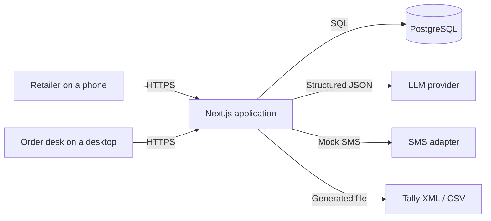
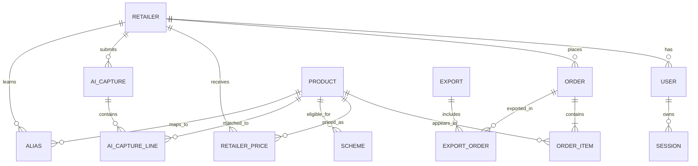
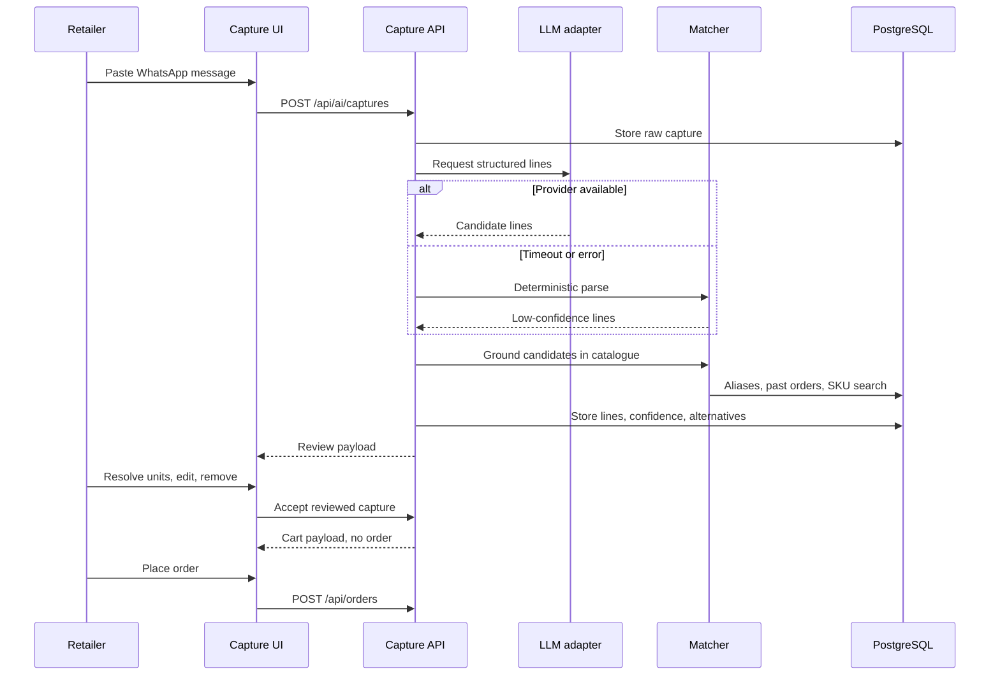

# Architecture — Sahaj Order

**Status:** Core slice implemented; deployment pending  
**Last updated:** 3 November 2026  
**Related:** [`PRD.md`](./PRD.md), [`ROADMAP.md`](./ROADMAP.md), [`plans/2026-11-02-sahaj-order-implementation-v1.md`](./plans/2026-11-02-sahaj-order-implementation-v1.md)  
**Change history:** [`memory.md`](./memory.md)

---

## 1. Purpose and Scope

Sahaj Order is a B2B ordering product for a packaged food and home care distributor. This document describes the architecture for the core slice:

- Retailer catalogue with the retailer's own price, GST treatment, stock status, and active schemes.
- Cart and order flow with automatic free goods, slab discounts, credit checks, and order history.
- AI capture from a pasted text order, with confidence, alternatives, unit clarification, and human confirmation.
- Order desk with a review queue, credit holds, confirmation, Tally export, and audit.
- Two primary roles: retailer and order desk. An admin role exists for seeding and future master-data management.

The architecture is deliberately small: one Next.js application, one PostgreSQL database, one AI provider adapter, and file-based Tally export. The goal is a product a reviewer can use in seven days, not a platform.

**Not in this architecture:** offline salesman sync, photo/voice capture, payments, delivery tracking, GST e-invoicing, two-way Tally sync, multi-warehouse, native mobile apps, and a full admin CMS.

---

## 2. Architecture Goals and Constraints

| Goal                                | Constraint                                      | Architectural response                                                                        |
| ----------------------------------- | ----------------------------------------------- | --------------------------------------------------------------------------------------------- |
| Ship the core slice in 7 days, solo | Limited time, no separate frontend/backend team | One Next.js monolith, one database, one deploy                                                |
| Fast on a low-end phone and slow 3G | First load under 3 seconds, large tap targets   | Server-rendered catalogue, optimized images, small client bundles, 360px-first UI             |
| Correct money and schemes           | Free goods, slabs, GST, paisa rounding          | Pure scheme engine, integer paisa, server-authoritative pricing, heavy unit tests             |
| Safe AI                             | The model can be wrong, slow, or unavailable    | Structured output, catalogue grounding, deterministic fallback, human confirmation gate       |
| Protect retailer prices and credit  | Commercial data is sensitive                    | Session-derived retailer scoping, role guards, no client-supplied retailer IDs                |
| Replace manual Tally entry          | Tally format is not specified                   | XML primary, CSV fallback, deterministic builder, export log and duplicate protection         |
| Keep the demo honest                | No fake AI, no dead buttons                     | Real provider call with a visible fallback; every screen has loading, empty, and error states |
| Keep the handover simple            | Reviewer needs a working demo                   | Seeded demo data, demo OTP, `deployment.md`, health endpoint                                  |

---

## 3. System Context



| Actor or system     | Responsibility                                                                             |
| ------------------- | ------------------------------------------------------------------------------------------ |
| Retailer            | Browses the catalogue, builds a cart, captures text orders, places and repeats orders      |
| Order desk          | Reviews AI and manual orders, manages credit holds, confirms, exports to Tally             |
| Admin               | Seeds and, in a future release, maintains master data                                      |
| Next.js application | UI, API, auth, domain logic, export generation                                             |
| PostgreSQL          | Users, retailers, catalogue, prices, schemes, orders, AI captures, aliases, exports, audit |
| LLM provider        | Extracts candidate lines from messy Hindi, English, or Hinglish order text                 |
| SMS adapter         | Mock OTP delivery in the demo; replaceable with a real provider later                      |
| Tally               | Receives a downloadable XML or CSV file; no live integration in the MVP                    |

---

## 4. High-Level Architecture

The application is a **modular monolith**:

```text
┌─────────────────────────────────────────────────────────────────────┐
│                         Next.js application                         │
│                                                                     │
│  ┌──────────────┐  ┌──────────────┐  ┌──────────────────────────┐  │
│  │ Retailer UI  │  │   Desk UI    │  │ Auth / login UI          │  │
│  │ (RSC + client│  │ (RSC + client│  │                          │  │
│  │  components) │  │  components) │  │                          │  │
│  └──────┬───────┘  └──────┬───────┘  └────────────┬─────────────┘  │
│         │                 │                       │                │
│         └─────────────────┴───────────┬───────────┘                │
│                                       ▼                            │
│                        Route handlers                               │
│                        auth guard → Zod validation → service       │
│                                       │                            │
│         ┌─────────────────────────────┼─────────────────────────┐  │
│         ▼                             ▼                         ▼  │
│  ┌──────────────┐            ┌─────────────────┐        ┌────────┐ │
│  │ Application  │            │  Domain modules │        │Infra   │ │
│  │ services     │            │                 │        │        │ │
│  │ catalogue    │            │ scheme engine   │        │AI      │ │
│  │ checkout     │            │ pricing         │        │adapter │ │
│  │ orders       │            │ AI matcher      │        │SMS     │ │
│  │ desk         │            │ Tally builder   │        │logging │ │
│  │ exports      │            │ credit rules    │        │rate    │ │
│  └──────┬───────┘            └─────────────────┘        │limits  │ │
│         │                                                └────────┘ │
│         ▼                                                           │
│  ┌───────────────────────────────────────────────────────────────┐  │
│  │ Drizzle data access                                            │  │
│  └───────────────────────────────┬───────────────────────────────┘  │
└──────────────────────────────────┼──────────────────────────────────┘
                                   ▼
                             PostgreSQL
```

**Why this shape**

- One deployable unit removes CORS, duplicated auth, and cross-service latency.
- Server Components keep the catalogue and order history fast on slow connections.
- Domain modules stay pure and testable; they do not import the database or the UI.
- Infrastructure adapters (AI, SMS, export) are replaceable without touching the domain.

**Request lifecycle**

1. The browser calls a route handler over HTTPS.
2. The auth guard resolves the session and role.
3. The input is validated with Zod.
4. The application service enforces retailer scope and business rules.
5. Domain modules calculate prices, schemes, confidence, or export data.
6. Drizzle reads or writes PostgreSQL inside a transaction where needed.
7. The service returns a typed result or a domain error.
8. The UI renders a success, empty, or error state with a clear next action.

---

## 5. Repository Layout (Implemented)

```text
/
├── app/
│   ├── (auth)/login/
│   ├── (retailer)/shop/
│   ├── (retailer)/cart/
│   ├── (retailer)/ai/
│   ├── (retailer)/orders/
│   ├── (retailer)/orders/[id]/
│   ├── (retailer)/account/
│   ├── (desk)/desk/
│   ├── (desk)/desk/orders/[id]/
│   ├── (desk)/desk/exports/
│   └── api/
│       ├── auth/           # otp, verify, logout, me
│       ├── cart/preview/
│       ├── ai/captures/    # create, get, confirm
│       ├── orders/         # create, list, cancel
│       ├── desk/orders/[id]/action/
│       ├── exports/        # create, list, download
│       ├── language/
│       └── health/
├── components/
│   ├── ui/                 # logo, spinner
│   ├── auth/               # login form, logout
│   ├── retailer/           # catalogue, cart, AI review, stepper, nav
│   ├── orders/             # status pill
│   └── desk/               # queue nav, order actions, export panel
├── lib/
│   ├── auth/               # OTP, sessions, phone, crypto, constants
│   ├── db/                 # schema, client, seed data
│   ├── catalogue/          # price resolution, stock status, search
│   ├── schemes/            # pure scheme engine and types
│   ├── pricing/            # line totals, GST, paisa rounding
│   ├── cart/               # browser cart persistence
│   ├── orders/             # preview pricing, lifecycle, credit, idempotency
│   ├── ai/                 # normalise, parser, provider, service
│   ├── exports/            # Tally XML/CSV builder and export service
│   ├── security/           # in-process fixed-window rate limits
│   ├── validation/         # shared Zod schemas
│   ├── http/               # API response and error helpers
│   ├── config/             # env validation
│   ├── infra/              # mock SMS adapter
│   └── i18n.ts             # retailer Hindi/English strings
├── drizzle/                # generated SQL migrations
├── scripts/                # migrate, seed, reset, env loader
├── tests/unit/             # schemes, AI parser, Tally
├── public/                 # icons and PWA assets
├── plans/
├── PRD.md
├── ROADMAP.md
├── architecture.md
├── memory.md
├── README.md
└── deployment.md
```

Rules:

- Domain modules in `lib/schemes`, `lib/pricing`, `lib/ai/parser.ts`, `lib/ai/normalize.ts`, and `lib/exports/tally.ts` never import React or the database client.
- Only application services (`lib/orders`, `lib/ai/service.ts`, `lib/exports/service.ts`, `lib/catalogue`) and route handlers touch both the database and the domain.
- UI components do not calculate money. Client-side previews call `/api/cart/preview`; the checkout path re-prices again on the server.
- Shared Zod schemas live in `lib/validation/order.ts` so route handlers validate one shape.

---

## 6. Module Boundaries

| Module            | Responsibility                                                                      | Key inputs and outputs                                          | Dependencies                          | Tests              |
| ----------------- | ----------------------------------------------------------------------------------- | --------------------------------------------------------------- | ------------------------------------- | ------------------ |
| Auth and RBAC     | OTP challenge, session creation, role resolution, route guards                      | Phone + OTP → session; session → user/role                      | Database, SMS adapter                 | Unit + integration |
| Catalogue         | Product listing, search, retailer price resolution, stock status, scheme badges     | Retailer + filter → product cards                               | Database, pricing read model          | Unit + integration |
| Scheme Engine     | Pure calculation of eligibility, free goods, slab discounts, savings, explanations  | Cart lines + active schemes + stock → priced lines and warnings | None                                  | Heavy unit tests   |
| Pricing           | Line and order totals, GST-inclusive/exclusive handling, paisa rounding             | Priced lines → totals and tax breakup                           | Scheme Engine                         | Unit               |
| Cart and Checkout | Cart validation, server re-pricing, stock reservation, credit check, order creation | Cart payload + idempotency key → order or domain error          | Pricing, Orders, Database             | Unit + integration |
| Orders            | Lifecycle transitions, history, repeat order, cancellation, audit                   | Order commands → order state                                    | Database, Pricing                     | Integration        |
| AI Capture        | Text extraction, candidate generation, confidence policy, provenance                | Raw text + retailer → capture lines and review state            | AI adapter, Alias Resolver, Catalogue | Unit + integration |
| Alias Resolver    | Exact, normalized, fuzzy, and past-order matching; retailer-scoped learning         | Raw term + retailer → ranked SKU candidates                     | Catalogue, Database                   | Unit               |
| Desk              | Queue, filters, detail, credit decisions, confirmation                              | Desk commands → order state and audit                           | Orders, AI Capture                    | Integration + E2E  |
| Tally Export      | Build XML/CSV, record export, prevent duplicates, authorize download                | Confirmed orders → file + export record                         | Orders, Database                      | Unit + integration |
| Admin             | Master data CRUD                                                                    | Commands → catalogue state                                      | Database                              | Stretch            |
| Shared            | Environment validation, logging, rate limits, error mapping                         | Cross-cutting                                                   | None                                  | Unit               |

**Deep modules worth protecting**

1. **Scheme Engine** — a simple function signature hides eligibility, free goods, slabs, stock caps, rounding, and explanations. It should not know about HTTP or SQL.
2. **AI Capture** — a single capture call hides provider calls, prompt versioning, grounding, fallback parsing, confidence, alternatives, and provenance. It should not place orders.
3. **Tally Export** — a single export call hides XML/CSV generation, ordering, totals, checksums, and duplicate rules.

---

## 7. Data Architecture

**Database:** PostgreSQL.  
**ORM:** Drizzle with SQL migrations.  
**Money:** integer paisa.  
**Quantities:** integer cases.  
**Timestamps:** UTC in the database, Asia/Kolkata in the UI.  
**Seed:** deterministic and idempotent; safe to rerun in a demo environment.

### 7.1 Entity groups

| Group            | Entities                                | Purpose                                      |
| ---------------- | --------------------------------------- | -------------------------------------------- |
| Identity         | User, Retailer, Session, OtpChallenge   | Sign-in, roles, retailer scoping             |
| Catalogue        | Brand, Category, Product, RetailerPrice | What can be ordered and at what price        |
| Commercial       | Scheme                                  | Free goods and slab discounts                |
| Ordering         | Order, OrderItem                        | The order record and its priced lines        |
| AI               | AiCapture, AiCaptureLine, Alias         | Raw input, review state, learned corrections |
| Audit and export | Export, ExportOrder, AuditLog           | Traceability and duplicate protection        |

### 7.2 Relationships



### 7.3 Key constraints and indexes

| Constraint                                                            | Why                                   |
| --------------------------------------------------------------------- | ------------------------------------- |
| Unique user phone                                                     | One login identity per phone          |
| Unique retailer phone                                                 | One shop account per phone in the MVP |
| Unique product SKU code                                               | Stable catalogue identity             |
| Unique retailer price on retailer + product + validity window         | No ambiguous price resolution         |
| Unique alias on retailer + raw term                                   | One learned meaning per shop          |
| Unique order idempotency key per retailer                             | Retried checkout cannot duplicate     |
| Unique export + order in ExportOrder, and unique order across exports | An order is exported at most once     |
| Index on order retailer, status, created date                         | Fast retailer history and desk queue  |
| Index on AI capture retailer and created date                         | Capture history and debugging         |
| Index on product category, brand, active                              | Catalogue filters                     |
| Check constraints for non-negative quantities and paisa               | Defensive data integrity              |

### 7.4 Transaction boundaries

**Checkout transaction**

1. Begin.
2. Re-price lines with the current retailer prices and active schemes.
3. Lock and verify stock for paid and free lines.
4. Decrement stock.
5. Compute the payable total and compare it with available credit.
6. Insert the order and items with status `pending` or `credit_hold`.
7. Insert the audit entry.
8. Commit.

If any step fails, roll back. The client receives a typed error such as `STOCK_CHANGED`, `PRICE_CHANGED`, `SCHEME_CHANGED`, or `CREDIT_EXCEEDED`, with a user-readable message and the affected lines.

**Export transaction**

1. Begin.
2. Verify every selected order is `confirmed` and not already exported.
3. Build the export record and `ExportOrder` rows.
4. Mark orders `exported`.
5. Insert the audit entry.
6. Commit.
7. Generate and return the file from the committed data.

**Cancellation transaction**

1. Begin.
2. Verify the order is cancellable.
3. Restore stock for paid and free lines.
4. Set status `cancelled`.
5. Insert the audit entry.
6. Commit.

### 7.5 Seed data

- Four brands, 33 SKUs, including the three sample SKUs.
- Ten fictional retailers with credit limits and outstanding balances.
- Three desk users and one admin.
- Six schemes: buy-X-get-Y, slab, and one expired rule.
- Twenty past orders across statuses.
- The brief's raw message and a second message with an unclear unit.
- Consistent packshot images, Hindi aliases, and stock levels.

---

## 8. Core Flows

### 8.1 Retailer login

1. The retailer enters a registered phone number.
2. The server creates a hashed OTP challenge and asks the SMS adapter to send it. In the demo, the adapter returns a fixed OTP for seeded numbers.
3. The retailer enters the OTP.
4. The server verifies the hash, expiry, and attempt count, then creates an opaque session and sets an httpOnly cookie.
5. The retailer is redirected to the catalogue.

Failure states: unknown phone, expired code, too many attempts, rate limit, SMS adapter failure, and an already-used code. Each has a specific message and a recovery action.

### 8.2 Catalogue and price resolution

1. The server resolves the retailer from the session.
2. Products are filtered by active status, category, brand, and search term.
3. The price is the active retailer override, or the product dealer price.
4. Stock status is derived from `stockCases` and `lowStockThreshold`: out at zero, low at or below the threshold, in otherwise.
5. Active schemes are attached to the product card.
6. The client renders responsive cards with a quantity stepper; there is no separate product-detail route in this slice.

### 8.3 Cart and scheme application

1. The retailer adds cases with a stepper.
2. The client cart persists locally so an accidental close does not lose it.
3. The client calls `/api/cart/preview` on a debounce; the server re-prices with the same engine used at checkout.
4. Free goods and slab discounts are shown as separate lines and explanations.
5. Near-miss nudges show the quantity gap for the next scheme.
6. The credit bar shows available limit versus the current payable total.
7. The server remains the final authority at checkout.

### 8.4 Checkout

1. The client sends the cart, a client-generated idempotency key, and an optional note.
2. The server validates the payload and derives the retailer from the session.
3. The server re-prices every line using current prices and schemes.
4. The server checks and reserves stock atomically.
5. The server compares the payable total with available credit.
6. The server creates the order as `pending` or `credit_hold`.
7. The server returns the order number, status, totals, and a confirmation link.
8. A retry with the same key returns the same order instead of creating a duplicate.

### 8.5 AI capture



**Hard rules**

- The model never receives phone, address, credit, or other retailer data.
- Every candidate SKU is grounded in the catalogue; hallucinated SKUs are discarded.
- No order is created until a person reviews and confirms.
- Unclear units are asked, not guessed.
- Corrections become retailer-scoped aliases.
- Provider failure produces a visible fallback, not a dead end.

### 8.6 Desk review and confirmation

1. The desk opens the queue and filters by status, search term, or date.
2. The desk opens an order and sees the raw message beside parsed lines, scheme explanations, totals, credit, and audit timeline.
3. Low-confidence AI lines are highlighted for review; the accepted lines are already immutable order items by this point.
4. Line corrections and alias learning happen in the retailer review screen before acceptance; the desk does not edit order lines in this slice.
5. If the order exceeds credit, the desk can approve or reject the hold with a reason.
6. Confirming moves the order to `confirmed` and records an audit entry; re-confirming a confirmed or exported order is a no-op.
7. Cancelling restores stock and records an audit entry; exported orders cannot be cancelled.

### 8.7 Tally export

1. The desk selects one or more confirmed orders.
2. The server rejects any order that is not confirmed or has already been exported.
3. The server builds one XML file per batch with one voucher per order, or a CSV fallback. Mixed retailers are allowed in a batch.
4. The server records the export, its orders, checksum, actor, and timestamp.
5. The orders move to `exported`.
6. The desk downloads the file; a second export of the same order is blocked in either format.

### 8.8 Repeat order

1. The retailer opens a past order.
2. The server or client reconstructs the cart lines.
3. Current prices, stock, schemes, and credit are revalidated.
4. Unavailable lines are flagged and the retailer can remove or replace them.
5. The retailer places the order through normal checkout.

---

## 9. Scheme Engine

**Shape:** a pure function with no database, HTTP, or React dependency.

**Inputs**

- Retailer identity and segment (all retailers in the MVP).
- Cart lines: product ID and paid quantity in cases.
- Evaluation date and time.
- Active schemes for the products.
- Current stock for paid and free products.

**Outputs**

- Priced lines with paid quantity, free quantity, unit price, discount, line total, scheme ID, and explanation.
- Totals: subtotal, discount, taxable value, GST, and payable total.
- Warnings: out of stock, free-stock shortfall, price changed, scheme expired.
- Nudges: the quantity gap to the next slab or free-good threshold.

**Rule precedence**

1. Ignore inactive, out-of-window, or ineligible schemes.
2. Resolve the retailer price for each line.
3. Choose at most one scheme per SKU: highest saving, then lower priority number.
4. Calculate free goods from paid quantity only.
5. Apply slab discounts to paid quantity only.
6. Cap free goods at available free stock and explain the shortfall.
7. Round half-up at line level, then reconcile the order total.
8. Return an explanation for every applied or skipped scheme.

**Why one scheme per SKU:** stacking is a commercial policy decision. The brief asks for free goods and slabs; it does not define stacking. One best scheme is understandable, testable, and easy to explain to a retailer.

**Test matrix:** exact threshold, one below, overlap, expired, free-stock cap, rounding at half-paisa, multiple lines of the same SKU, free goods excluded from the next scheme, and credit impact after discount.

---

## 10. AI Capture

**Architecture:** hybrid extraction and grounding.

| Layer                | Job                                                                            | Failure behaviour                                                 |
| -------------------- | ------------------------------------------------------------------------------ | ----------------------------------------------------------------- |
| Provider adapter     | Calls the LLM with a strict schema and returns candidate lines                 | Timeout or error triggers the deterministic fallback              |
| Deterministic parser | Extracts quantity and unit patterns from raw text                              | Runs on every capture as a cross-check                            |
| Catalogue matcher    | Exact alias, normalized name, token overlap, fuzzy match, past-order frequency | Returns ranked candidates; never invents a SKU                    |
| Confidence policy    | High, medium, low, unit-unclear                                                | Controls what the UI pre-selects and what requires a choice       |
| Review UI            | Shows raw text, matched SKU, alternatives, confidence, unit question           | The retailer or desk resolves every uncertain line                |
| Alias learner        | Saves corrections per retailer                                                 | Improves future captures; never changes global data without admin |
| Provenance store     | Raw text, model, prompt version, confidence, resolution                        | Enables audit and evaluation                                      |

**Confidence bands**

- High: 0.85 and above. Preselected, still requires review and confirmation.
- Medium: 0.60–0.84. Two alternatives shown; the reviewer must choose.
- Low: below 0.60. No preselection; manual SKU search.
- Unit unclear: no acceptance until case or piece is resolved. Piece ordering is explained but not supported in the MVP.

**Grounding rule:** the LLM proposes; the catalogue disposes. Every SKU ID in the response is validated against the seeded catalogue. The matcher can override the model. This is the main defence against hallucinated products and wrong pack sizes.

**Why not LLM-only:** the model does not know the distributor's SKU codes, pack sizes, stock, prices, or schemes. Sending the full catalogue on every request is expensive and still does not guarantee correctness. The hybrid keeps the model for language and the database for truth.

**Why not rules-only:** Hindi/Hinglish order text is too varied for a small regex set. The LLM handles phrasing and quantity language; the deterministic path keeps the product usable when the provider is unavailable.

---

## 11. Auth, Security, and Data Isolation

**Authentication**

- Six-digit OTP, five-minute expiry, five attempts, 60-second resend cooldown.
- OTP hashed with a server pepper; no plaintext codes in the database or logs.
- Opaque session token in an httpOnly, secure, SameSite=Lax cookie; only the token hash is stored.
- Seven-day session expiry, a fresh opaque session on each login, revocation on logout.

**Authorization**

| Action                         | Retailer | Desk                         | Admin  |
| ------------------------------ | -------- | ---------------------------- | ------ |
| View own catalogue and prices  | Yes      | Yes, all retailers           | Yes    |
| View own credit and orders     | Yes      | Yes, all retailers           | Yes    |
| Place an order                 | Yes      | No in the MVP                | No     |
| Capture with AI                | Yes      | Yes, on behalf of a retailer | Yes    |
| Hold, approve, confirm, cancel | No       | Yes                          | Yes    |
| Export to Tally                | No       | Yes                          | Yes    |
| Manage master data             | No       | No                           | Future |

**Isolation rule:** the retailer ID always comes from the session. A request body or query parameter cannot select a different retailer. Every order, price, credit, AI capture, and alias query is scoped by that ID. Desk reads are explicitly role-checked.

**Other controls**

- Zod validation at every boundary; reject unknown fields.
- Origin checks and SameSite cookies for mutation CSRF.
- Rate limits on OTP request, OTP verify, AI capture, and order creation.
- Security headers: CSP, HSTS, X-Content-Type-Options, Referrer-Policy.
- No secrets in the repository; environment variable names only in `.env.example`.
- Fictional seed data; phone numbers and order text redacted from logs.
- Audit entries for confirmations, holds, cancellations, alias changes, and exports.
- Export downloads require desk or admin role and an export ID the user is allowed to read.

---

## 12. UI Architecture

**Rendering:** Server Components for catalogue, order history, order detail, and desk queue. Client Components only where interaction requires it: login, cart, AI review, filters, desk actions, export panel, and language toggle.

**Layouts**

- `(auth)` layout: centered, minimal, mobile-first login.
- `(retailer)` layout: bottom navigation, cart count, cool neutral canvas, large tap targets.
- `(desk)` layout: desktop-first queue with a detail page; stacks on mobile.

**State**

- Server state comes from server components and route handlers.
- The cart is client state persisted in `localStorage`, then previewed and validated on the server.
- AI capture review state is server-owned until the reviewer accepts it; the accepted payload becomes a cart, not an order.
- Desk filters and status tabs live in the URL so a refresh keeps context.

**Design system**

- Visual language adapted from `ui-inspo.html` (Alphaguard): cool `#f2f2f2` canvas, near-black `#0b0306` ink, white surfaces, and celadon `#238365` as the single action accent.
- Space Grotesk for display headings and prices; Inter for body; Noto Sans Devanagari for Hindi. Loaded and self-hosted through `next/font/google`.
- 12px cards, 6–8px buttons and fields, 1px hairline borders, minimal shadows, and a `#4d65ff` keyboard focus ring.
- Dark blueprint-grid hero panels for AI, login, and promotional surfaces.
- Amber for low stock and credit holds, red for out-of-stock and destructive actions, blue for export/integration notes.
- Large price numerals, 44px tap targets, 16px body text.
- CSS-drawn monochrome packshots keyed by product, not mismatched stock photos.
- No gradients, no generic AI purple, no decorative illustrations without a purpose.

**Implemented screens**

1. Login / OTP (`/login`).
2. Catalogue (`/shop`).
3. Cart / checkout (`/cart`).
4. AI capture and review (`/ai`).
5. Order history (`/orders`) and detail (`/orders/[id]`).
6. Account (`/account`).
7. Desk queue (`/desk`).
8. Desk order detail and export (`/desk/orders/[id]`).
9. Export log (`/desk/exports`).

**States**

- Loading skeletons or spinners for catalogue, orders, AI, desk, and account routes.
- Empty states with one next action.
- Error states with a retry and a human-readable message.
- Inline validation and disabled buttons with a reason.
- Success feedback and a clear next step.
- No offline banner or offline mode in this slice.

**Internationalisation**

- Retailer-facing navigation, shop header, cart, AI, orders, account, and status labels have a Hindi/English toggle.
- The choice persists to `retailers.language`, so it survives reload and sign-in.
- Product names carry Hindi aliases; AI examples include Hindi and Hinglish.
- Desk and admin screens remain English in the MVP.

**PWA**

- Ships a web app manifest, theme colour, 192/512 icons, and a maskable icon.
- No service worker: the app is installable but explicitly not offline-first, so prices and stock are never served stale.

**Performance**

- Server-render above-the-fold content; keep catalogue and desk interactions client-side only where needed.
- Packshots are CSS/SVG keyed by product, so there are no large product photographs to load.
- Split retailer and desk routes through the App Router.
- Target budgets: LCP under 3 seconds on Slow 3G, under 2.5 seconds on 4G; initial JS under 200 KB gzipped; Lighthouse mobile at least 85.
- These budgets are targets, not measured results in this slice.

---

## 13. API Architecture

**Style:** REST-like route handlers under `/api`. Every endpoint returns a typed JSON result or a typed domain error. Catalogue, order history, order detail, and desk queue reads are Server Components, so they do not need duplicate JSON endpoints.

| Area       | Implemented endpoints                                                                      | Role                   |
| ---------- | ------------------------------------------------------------------------------------------ | ---------------------- |
| Auth       | `POST /api/auth/otp`, `POST /api/auth/verify`, `POST /api/auth/logout`, `GET /api/auth/me` | Public / authenticated |
| Cart       | `POST /api/cart/preview`                                                                   | Retailer               |
| AI capture | `POST /api/ai/captures`, `GET /api/ai/captures/[id]`, `POST /api/ai/captures/[id]/confirm` | Retailer               |
| Orders     | `GET /api/orders`, `POST /api/orders`, `POST /api/orders/[id]/cancel`                      | Retailer               |
| Desk       | `POST /api/desk/orders/[id]/action`                                                        | Desk, admin            |
| Exports    | `GET /api/exports`, `POST /api/exports`, `GET /api/exports/[id]`                           | Desk, admin            |
| Language   | `POST /api/language`                                                                       | Retailer               |
| Health     | `GET /api/health`                                                                          | Public                 |

**Error model:** a stable code, an HTTP status, a user-readable message, and optional field errors. Examples: `UNAUTHENTICATED`, `FORBIDDEN`, `VALIDATION_FAILED`, `STOCK_CHANGED`, `CREDIT_EXCEEDED`, `ORDER_NOT_CANCELLABLE`, `ALREADY_EXPORTED`.

**Idempotency:** order creation accepts a client-generated key; a repeated request with the same key returns the original order. Export creation is protected by the `ExportOrder` uniqueness rule and a pre-export check.

**Pagination:** not implemented in this slice. Retailer history reads the latest 50 orders, the desk queue the latest 100, and the export log the latest 30. The seed is small; add cursor paging before a real catalogue or order volume.

---

## 14. Deployment and Operations

**Current status:** the app runs locally against Docker Compose PostgreSQL and has been verified with a production build and an authenticated end-to-end smoke flow. No public deployment exists yet.

**Target:** Vercel for the Next.js app, Neon or Supabase for PostgreSQL. A Docker Compose PostgreSQL path is documented for local development, and [`deployment.md`](./deployment.md) contains the release checklist.

```text
Browser
  │ HTTPS
  ▼
Vercel (Next.js app)
  ├── /api/* route handlers
  ├── server components
  └── static assets
        │
        ├── Neon Postgres (pooled connection)
        └── LLM provider (server-side only)
```

**Environments**

- Local: `.env.local`, Docker PostgreSQL on `localhost:5435`, seeded demo data. Verified.
- Preview: not deployed yet. Use the Vercel steps in `deployment.md` when required.
- Production: not deployed yet. Seed idempotently, set a real `APP_URL`, and remove `DEMO_OTP` for real users.

**Environment variable names**

- `DATABASE_URL`
- `AUTH_SECRET`
- `OTP_PEPPER`
- `DEMO_OTP` (non-production only)
- `SMS_PROVIDER`
- `SMS_API_KEY`
- `AI_PROVIDER`
- `AI_MODEL`
- `AI_API_KEY`
- `APP_URL`
- `EXPORT_SIGNING_SECRET`

Values never enter the repository. `.env.example` lists names and safe local placeholders only; `deployment.md` lists the release steps and demo logins.

**Operations**

- Migrations run as a release step, not on every request.
- Seed is idempotent and safe to rerun.
- `/api/health` checks the database and returns a minimal status.
- Audit log is append-only and separate from application logs.
- AI fallback logs record provider and reason only; raw order text, phone numbers, OTPs, and secrets are not logged.
- Request IDs and structured production logging are not implemented yet; add them with the deployment.
- Rollback: redeploy the previous build and reverse the last migration only if it is backward compatible; otherwise restore from a pre-release snapshot.

---

## 15. Performance and Reliability

| Concern            | Design response                                                                                    |
| ------------------ | -------------------------------------------------------------------------------------------------- |
| Slow 3G first load | Server-rendered catalogue, optimized images, font subsetting, small client bundle, route splitting |
| Large catalogue    | Paginated or virtualised lists only if the seed grows; 32 SKUs do not need it                      |
| Checkout races     | Stock row locks inside a transaction; idempotency key prevents duplicate orders                    |
| AI latency         | 9-second timeout, one retry, visible fallback, no blocking of manual ordering                      |
| AI provider outage | Deterministic parser and manual catalogue path                                                     |
| Duplicate exports  | `ExportOrder` uniqueness and a pre-export check                                                    |
| Stale prices       | Server re-prices at checkout; client preview is not authoritative                                  |
| Schema drift       | Versioned SQL migrations and a schema review in CI                                                 |
| Log noise          | Structured logs, request IDs, redaction, no PII                                                    |
| Demo recovery      | Idempotent seed, health check, rollback note, local Docker path                                    |

**Reliability rule:** the product must degrade to a working manual flow. If AI is down, the retailer can still order. If the desk is slow, the retailer still sees the order status. If an export fails, the order remains confirmed and retryable.

---

## 16. Testing Architecture

**Implemented**

- **Unit:** 45 Vitest tests across the scheme engine/pricing, AI normalisation and parser, and Tally XML/CSV builders. They run with no database.
- **Manual runtime smoke:** OTP login for retailer and desk, catalogue/cart/order pages, Hindi AI capture and confirmation, manual order creation, credit hold and approval, desk confirmation, XML and CSV export, download, duplicate-export 409, role denial, and cross-retailer isolation. Verified against the local dev server and a production build.
- **Build verification:** `pnpm lint`, `pnpm typecheck`, `pnpm test`, and `pnpm build` all pass.

**Planned**

- **Integration:** OTP/session persistence, order lifecycle, idempotency, AI capture resolution, and export duplicate prevention against a test database with migrations and deterministic fixtures.
- **End-to-end:** Playwright against a production build for the retailer manual order, retailer AI order, desk confirm/export, cross-retailer isolation, and AI failure fallback.
- **Performance:** Lighthouse mobile and Slow 3G throttling at 360px.
- **Security:** authorization matrix, rate limits, malformed inputs, secret scan, dependency audit.
- **Data:** seed validation and the ten-message AI evaluation set (the parser eval is present; it is not yet run against a live provider).

**Test principles**

- Assert external behaviour, not private functions.
- Use explicit fixtures and deterministic dates.
- Avoid depending on seed order; query by stable identifiers.
- Run the scheme matrix on every change to the engine.
- Keep the E2E suite small and focused on the flows that matter.

---

## 17. Decisions and Trade-offs

| Decision                                      | Alternative                       | Why                                                                                                   | Consequence                                                                                                                                    |
| --------------------------------------------- | --------------------------------- | ----------------------------------------------------------------------------------------------------- | ---------------------------------------------------------------------------------------------------------------------------------------------- |
| Next.js modular monolith                      | Separate SPA and API              | One deploy, one auth boundary, server rendering, faster solo delivery                                 | Less independent scaling; acceptable at this size                                                                                              |
| PostgreSQL + Drizzle                          | SQLite or Prisma                  | Relational integrity, transactions, row locks, light runtime                                          | Requires a managed database and migrations                                                                                                     |
| Client cart with server re-pricing            | Server-side draft cart            | Simpler state, fewer endpoints, safe server authority at checkout                                     | No cross-device cart continuity in the MVP                                                                                                     |
| Hybrid AI with deterministic fallback         | LLM-only or rules-only            | Language understanding plus catalogue grounding and graceful failure                                  | More code, but the AI is honest and demoable                                                                                                   |
| Two scheme types, one best per SKU            | Generic rule engine with stacking | Matches the brief, testable, explainable                                                              | Less commercial flexibility; future rules need engine work                                                                                     |
| Reserve stock at order placement              | Reserve at desk confirmation      | Prevents overselling and makes the retailer's confirmation meaningful                                 | Holds stock for credit-hold orders until the desk acts                                                                                         |
| Tally XML with CSV fallback                   | CSV only                          | Stronger automation demo; fallback covers format uncertainty                                          | XML format is an assumption to label                                                                                                           |
| Seed-only admin                               | Full admin CMS                    | Focus time on the core slice and polish                                                               | Master data changes require a developer in the MVP                                                                                             |
| Hindi/English toggle on retailer screens      | English-only or full bilingual    | Meets the language constraint without doubling all content work                                       | Desk and long-form content remain English                                                                                                      |
| Opaque, hashed DB sessions                    | JWT in a cookie                   | Immediate revocation by logout, one server-side source of truth                                       | One database read per request, cached per render                                                                                               |
| Deterministic parser as the default demo path | Require a live provider key       | The demo works offline and the failure path is honest; the adapter is still exercised when configured | Provider quality is not evaluated without a key                                                                                                |
| In-process fixed-window rate limits           | Redis-backed limiter              | No extra infrastructure for a single-instance demo                                                    | Limits reset on restart and are not shared across instances                                                                                    |
| Ship a compact core screen set                | Build the full must-have list     | The brief rewards a small part done well                                                              | The slice adds account, order detail, and export log around the seven core flows; offline, photo/voice, van loading, and dashboard are stretch |

---

## 18. Future Evolution

| Future capability          | How it fits without redesign                                                                                                                          |
| -------------------------- | ----------------------------------------------------------------------------------------------------------------------------------------------------- |
| Offline salesman mode      | Add IndexedDB storage and a sync queue in the retailer client; reuse the idempotent order endpoint; server remains authoritative for stock and credit |
| Photo capture              | Upload to object storage, run OCR or a vision model, feed the extracted text into the existing capture pipeline                                       |
| Hindi voice notes          | Add speech-to-text before the capture pipeline; keep the same confidence and review UI                                                                |
| Van loading list           | Generate a pick list from confirmed orders; add a warehouse view over the existing order model                                                        |
| 14-day inactive retailers  | Add a read-only query and dashboard over orders and retailers                                                                                         |
| Admin CRUD                 | Add role-guarded forms over the existing catalogue, price, scheme, and retailer tables                                                                |
| Real SMS/WhatsApp          | Replace the SMS adapter; keep OTP and notification interfaces unchanged                                                                               |
| Tally two-way sync         | Add a connector service; keep the export builder and audit trail                                                                                      |
| Payments and credit ledger | Add a payment entity and allocation rules; the order total and credit check already exist                                                             |
| Multi-warehouse            | Add a warehouse dimension to stock and orders; the scheme engine remains per line                                                                     |

The architecture avoids premature abstractions. Each future item adds a module or a dimension rather than rewriting the core.

---

## 19. Risks and Open Questions

| Item          | Current position                                                                   | Needs confirmation                                               |
| ------------- | ---------------------------------------------------------------------------------- | ---------------------------------------------------------------- |
| Deadline      | 7 days from 2 November 2026                                                        | Actual submission deadline                                       |
| AI provider   | Adapter implemented for OpenAI/Anthropic; demo uses the deterministic parser       | Provider, model, key, quota, and a live evaluation               |
| Deployment    | Local Docker + production build verified; public deploy pending                    | Whether a live app is required                                   |
| Admin         | Seed-only in the MVP                                                               | Whether a minimal CRUD screen is expected                        |
| Tally format  | Tally Prime XML, CSV fallback; XML structurally tested but not imported into Tally | Client's Tally version, company, ledger names, and import format |
| GST           | Dealer prices treated as inclusive                                                 | Whether real prices are inclusive or exclusive                   |
| Ordering unit | Cases; piece ordering explained only                                               | Whether retailers ever order loose pieces                        |
| Hindi         | Retailer toggle persisted to the retailer row; desk stays English                  | Depth of translation expected                                    |
| Credit        | Seeded limit and outstanding; hold workflow verified                               | Whether a payment ledger is expected in the slice                |

---

## 20. Change Tracking

This document describes the current architecture. Whenever a change alters a module boundary, data model, external dependency, deployment shape, or key decision:

1. Update the relevant section of this document in the same task.
2. Append an entry to [`memory.md`](./memory.md) with the change ID, files, rationale, and verification.
3. Note the architecture impact in the change entry.

`memory.md` is the chronological source of truth. This document is the current-state view.
